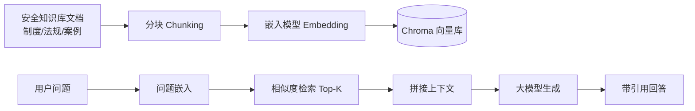
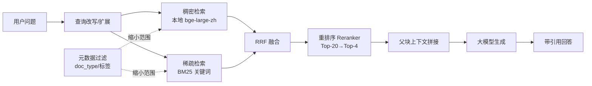

# 蜀道智能安全助手 — AI 技术方案文档

> 版本：v1.0 ｜ 技术栈基线：FastAPI + 国内大模型 + Chroma
>
> 覆盖任务书要求的：大模型选型对比、Prompt 模板、RAG 架构、知识库构建、向量库选型、性能优化。

---

## 1. 大模型选型对比

目标：中文安全领域问答 + 大纲/内容生成，需稳定 API、中文友好、可流式。

| 模型 | 厂商 | 中文能力 | 流式 | 工具/函数 | 备注 |
|------|------|---------|------|----------|------|
| **DeepSeek-V4-flash** | 深度求索 | 强 | 支持 | 支持 | 推理强、成本低（**主模型**） |
| **agnes-2.5-flash** | agnes | 中 | 支持 | 支持 | 极低价、需 VPN（**降级备选**） |
| **qwen3.8max** | 阿里 | 强 | 支持 | 支持 | **视觉子模型**：图片安全隐患排查 |
| 智谱 GLM-4 | 智谱 AI | 强 | 支持 | 支持 | 长上下文友好，适合长制度文档（对比参考） |
| 文心一言 ERNIE | 百度 | 强 | 支持 | 支持 | 合规，但生态略封闭（对比参考） |

**决策**：以 **DeepseekV4-flash** 为主模型，agnes2.5-flash 为降级备选,qwen3.8max作为图片中安全隐患排查的子智能体接入的模型。通过 **OpenAI 兼容 SDK**（`openai` 包，改 `base_url`/`api_key`）统一接入，便于热切换。

> **AI 编排框架（课程要求）**：AI 部分统一采用 **LangChain 1.x 架构**——LLM 调用走 `langchain_openai.ChatOpenAI`（主/备模型用 `with_fallbacks` 原生降级）、嵌入走 `langchain_huggingface.HuggingFaceEmbeddings`、向量检索走 `langchain_chroma.Chroma`（`get_vectorstore().as_retriever()`）、问答/PPT 链用 LCEL 编排；重排（bge-reranker-base）与结构感知分块等 LangChain 无原生实现的能力，保留自研实现并经 `RunnableLambda` 接入 LangChain 生态。对外接口签名（chat/chat_stream/embed_*/rerank）保持不变，业务层零改动。

### 1.1 视觉子智能体：图片隐患识别（正式功能）

> 说明：任务书未明确写出该需求，但项目确有图片隐患识别能力要求，视觉子智能体即为此设计。

- **功能定位**：H01 隐患上报的 AI 辅助研判——用户上传现场图片后，识别图片中的安全隐患，返回隐患类别、等级、整改建议。
- **输入**：现场图片（jpg/jpeg/png/webp，≤10MB）+ 可选现场文字描述。
- **输出**：JSON `{"detected": bool, "hazards": [{"category", "description", "level", "suggestion", "location"}], "summary"}`，等级沿用 重大/较大/一般/轻微 四级；`location` 为隐患边界框坐标 `[x1, y1, x2, y2]`（**qwen3.8max 实测具备目标检测/坐标输出能力**，公众号实测 + 领导小组实测；无法精确定位时模型输出 null，前端按示意框展示）。
- **实现**：`prompt/prompts.yml` 的 `hazard_vision` 场景（四段式，强制 JSON）+ `src/ai/vision.py`（OpenAI 兼容多模态调用，text + image_url data URI）。
- **接口**：`POST /api/vision/hazard`（复用图片上传校验链路，识别结果与图片 URL 一并返回）。
- **与 H01 衔接**：识别结果作为上报参考（可预填等级/类型），最终以上报人确认为准。
- **成本策略**：按次调用，演示场景用量小；API Key 配置于 `.env`（QWEN_API_KEY/QWEN_BASE_URL）。

---

## 2. Prompt 模板设计

采用"系统角色 + 任务 + 约束 + 输出格式"四段式，必要时注入检索片段（RAG）。

### 2.1 安全问答 Prompt（RAG 增强）

```
你是一名资深企业安全生产管理专家，服务于蜀道集团。
仅依据【参考资料】回答问题，资料不足时明确说明"依据现有资料无法确认"，不得编造。
保持专业、简洁，给出可操作建议。

【参考资料】
{retrieved_context}

【对话历史】
{history}

【用户问题】
{question}

【输出要求】
1. 直接回答，分点列出；
2. 若引用了资料，在末尾以 [来源: 文件名#段落] 标注（对应 A06 回答引用）。
```

### 2.2 PPT 大纲生成 Prompt（P01）

```
你是安全培训课件专家。根据主题生成一份安全讲座 PPT 大纲。
主题：{topic}
要求：
- 结构：封面 / 目录 / 3-6 个内容章节 / 结尾；
- 每个内容章节 3-5 个要点；
- 输出 JSON：{"title":..., "subtitle":..., "sections":[{"name":..., "points":[...]}, ...]}。
仅输出 JSON。
```

### 2.3 PPT 内容填充 Prompt（P05）

```
根据大纲章节，生成该页演讲要点与配图建议。
章节：{section_name}；要点雏形：{points}
输出 JSON：{"bullets":[...≤5条], "image_suggestion":"...安全主题配图描述"}。
```

---

## 3. RAG 架构说明

### 3.1 基线架构



### 3.2 优化后架构（混合检索 + 重排）



- **生成**：检索片段注入 Prompt 2.1 的 `{retrieved_context}`，大模型基于资料作答，降低幻觉（满足 A05/A06）。
- **重排序**：初召回候选经 Reranker 精排后再取 Top-K，显著提升相关性。
- **多轮**：会话历史存 Redis/MySQL，拼接 `{history}` 实现 ≥5 轮上下文（A01/A02）。

---

## 4. 知识库构建与分块策略

> 蜀道知识库是 **法规（章→节→条）、操作规程（工序步骤）、应急预案（响应阶段）、事故案例（结构化字段）** 的混合体。**分块是 RAG 质量的第一道关卡**——切坏了，后面检索再好也救不回。

### 4.1 分块总原则

- 不以固定字数硬切，优先**保持语义单元完整**（一条法规、一个工序、一个预案阶段不被劈开）。
- 中文按**字符**计（非 token）；单块 300–800 字，相邻块重叠 10–15% 防边界信息丢失。
- 每块必带元数据：`{doc, doc_type, chapter, article_no, tags, source}`（支撑 §5.2 过滤与 A06 引用溯源）。

### 4.2 结构感知分块（Structure-aware Chunking）

对结构化文档用正则/标题层级解析后切分，而非滑窗：

| 文档类型 | 切分粒度 | 说明 |
|---------|---------|------|
| 法律/法规/制度 | **以"条"为单元** | 每条一 chunk；章/节作为父级元数据，避免把"应当…"与"违反处…"劈开 |
| 操作规程 | **以工序/步骤为单元** | 按"作业前/作业中/作业后"或编号步骤切 |
| 应急预案 | **以响应阶段为单元** | 预警/响应/处置/恢复各成块 |
| 事故案例 | **按结构化字段切** | 原因 / 经过 / 教训 分块，并打 `accident_type` 标签 |

### 4.3 父子分块（Small-to-Big / Parent-Child）

- **子块（child）**：细粒度（如单条法规），用于**精确向量检索**，提升召回精度。
- **父块（parent）**：保留子块所属的完整章节（含导语/上下文），检索命中子块后**返回父块**喂给大模型。
- 效果：既搜得准，又给 LLM 完整语境，避免"答半截"。

### 4.4 嵌入模型

使用**本地模型 `D:/LLM/model/bge-large-zh`**（sentence-transformers 加载，默认 GPU/CUDA 推理，无 GPU 环境可切 CPU——用户决策，`EMBEDDING_DEVICE` 配置），中文检索效果好、免 API 调用、离线可用。查询与文档统一经本地模型嵌入（`src/ai/embeddings.py`），入库与检索均显式传向量，不依赖 Chroma 默认 MiniLM。

### 4.5 入库与更新

- 写入 Chroma 集合 `safety_kb`，持久化到本地目录（Docker 挂载卷）。
- 增量 `upsert`；后台定时或手动触发重建；建库时跑一次 **golden QA 集** 校验 Recall@K。

---

## 5. 检索方式优化

> 工人口语化提问（"高处作业有啥要求""脚手架怎么搭才合规"）是**语义+术语**混合查询。纯向量检索对"第三十条/脚手架"等精确关键词不敏感，必须混合检索。

### 5.1 混合检索（Hybrid Search）

- **稠密（Dense）**：问题经本地 `bge-large-zh` 嵌入 → Chroma 余弦相似度，抓语义相关性。
- **稀疏（Sparse）**：BM25 关键词匹配（`rank-bm25`），抓精确术语（条款号、专业名词）。
- **融合**：**RRF（Reciprocal Rank Fusion）** 合并两路排序，兼顾"懂意思"与"对得上词"。

### 5.2 元数据过滤（Metadata Filtering）

检索前先用结构化条件缩小范围，降低噪声：

```python
# 伪代码：先过滤再向量检索
chroma.query(
    query_texts=[question],
    where={"doc_type": "操作规程", "tags": {"$in": ["高处作业", "脚手架"]}},
    n_results=20,
)
```

### 5.3 重排序（Re-ranking）

- 初召回 Top-20 候选 → 经**本地 `bge-reranker-base`**（`D:/LLM/model/bge-reranker-base`，CrossEncoder）交叉编码精排 → 取 Top-4 喂 LLM。
- Reranker 比向量更懂"问题与片段是否真相关"，是提升答案精准度的关键一步。

### 5.4 查询改写（Query Rewriting / HyDE）

- **改写**：把口语/模糊问法扩写成若干子查询（如"有啥要求"→"高处作业的安全防护措施、审批流程、禁止行为"），分别检索后合并。
- **HyDE**：生成"假设性答案"向量再去检索，缓解短 query 语义稀疏问题。

---

## 6. RAG 优化路线图（分阶段、数据驱动）

| 阶段 | 目标 | 关键动作 | 验证指标 |
|------|------|---------|---------|
| **P0 基线** | 跑通可用 RAG | 固定窗口分块 + 稠密检索 Top-4 | 端到端能答 |
| **P1 分块治理** | 不切坏语义 | 结构感知分块 + 父子块 + 中文嵌入(本地 bge-large-zh) | Recall@4 ≥ 0.7 |
| **P2 混合检索** | 术语也能命中 | 稠密+稀疏 + RRF + 元数据过滤 | Recall@10 ≥ 0.85 |
| **P3 精排+改写** | 答案更准 | Reranker 重排 + 查询改写/HyDE | 人工评分 ≥ 4/5 |
| **P4 进阶（可选）** | 领域深化 | 事故案例知识图谱、嵌入微调、反馈闭环(基于 A07 点赞/踩) | 持续迭代 |

> 每阶段用固定 **golden QA 集**（人工标注 50–100 条问答对）测 Recall@K 与人工评分，作为调参依据，避免"拍脑袋优化"。

---

## 7. 向量数据库选型：Chroma

| 候选 | 结论 |
|------|------|
| Chroma | ✅ 选中：轻量、本地文件持久化、Python 原生、API 简单，适合课程项目快速落地；支持元数据过滤与混合检索原型 |
| Qdrant | 性能好、Docker 化，偏生产，本期过重 |
| Milvus | 企业级、分布式，学习/运维成本高 |

Chroma 以本地目录持久化，Docker 下挂载卷即可，无需独立服务进程，降低部署复杂度。混合检索可在应用层用本地 `bge-large-zh` 稠密向量 + `rank-bm25` 稀疏 + RRF 实现，无需换库。

---

## 8. 性能优化方案

| 瓶颈 | 优化 |
|------|------|
| 首字延迟（≤3s） | 流式输出（SSE）边生成边返回；检索 Top-K 控制规模（重排后仅取 4 块） |
| 检索延迟 | 嵌入模型本地/就近部署；Chroma 索引常驻内存；元数据过滤缩小候选集 |
| 并发 ≥50 QPS | FastAPI 异步 + gunicorn 多 worker；Redis 缓存热点会话与限流计数；embedding 结果缓存 |
| 大模型降级 | 主模型(DeepSeek)超时/限流自动切换 agnes-2.5-flash 备选，保证可用性 |
| 上下文膨胀 | 会话历史截断（保留最近 5 轮）+ 摘要压缩；仅注入父块而非全文档 |

---

## 9. 安全与合规

- **敏感词过滤**：问答前对用户问题做敏感词扫描（A 系列约束），命中则拦截或脱敏。
- **回答审计**：记录提问/回答/引用来源，便于复盘与优化（呼应 A07 点赞/踩反馈闭环）。
- **知识隔离**：RAG 仅检索企业授权知识库，避免模型泄露无关信息。
