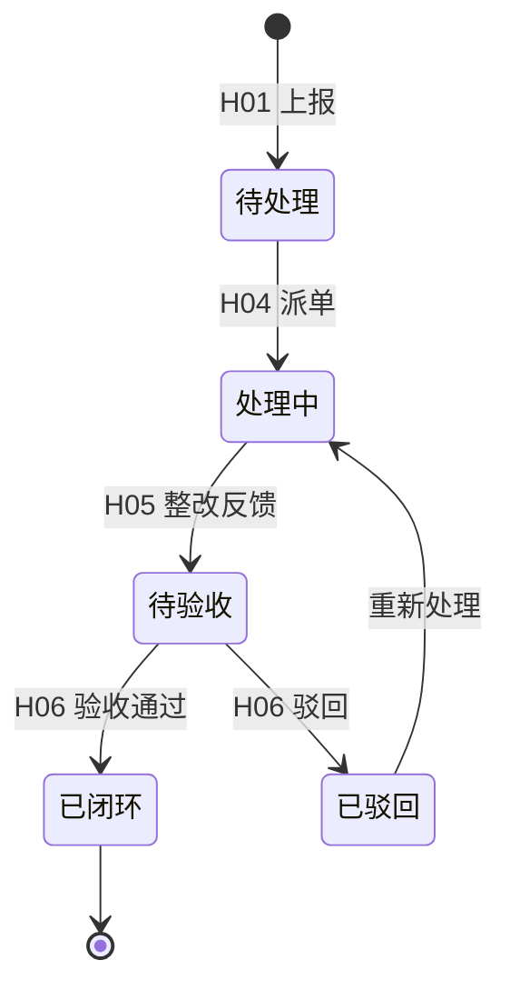
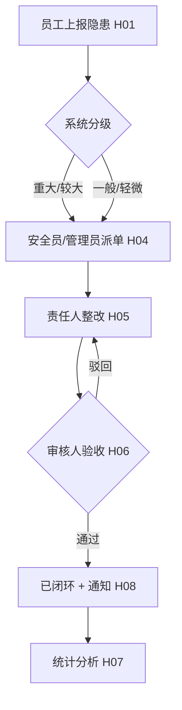
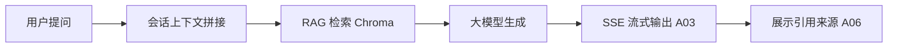
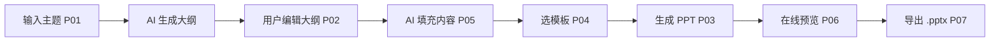

# 蜀道智能安全助手 — 产品需求文档（PRD）

> 版本：v1.0 ｜ 状态：草稿 ｜ 技术栈基线：Python FastAPI + Vue3 + MySQL + Redis + Chroma
>
> ⚠️ **技术栈说明**：任务书 1.3 原写"后端 Spring Boot / NestJS"，**实际后端采用 Python FastAPI**（本课设统一技术决策）。本文档所有后端相关描述均以 FastAPI 为准，前端、数据库、部署保持不变。

---

## 1. 产品概述与背景

蜀道集团作为大型交通建设企业，安全生产管理是核心业务。传统安全管理依赖纸质/表格流转，存在隐患上报不及时、整改闭环难追踪、安全培训资料分散等问题。

本产品旨在用 AI 技术赋能安全管理，打造集 **隐患排查闭环**、**智能安全问答（RAG）**、**安全讲座 PPT 智能制作** 于一体的企业级 Web 平台，提升安全管理效率与培训质量。

### 1.1 产品目标

1. 隐患从"上报→派单→整改→验收"全流程线上化、可视化闭环。
2. 基于企业安全知识库的 AI 问答，减少人工查制度的时间成本。
3. 输入主题即可 AI 生成规范的安全讲座 PPT，降低培训材料制作门槛。

### 1.2 用户角色

| 角色 | 标识 | 核心职责 | 主要可用功能 |
|------|------|---------|-------------|
| 管理员 | `admin` | 系统/用户/知识库管理、全局统计 | 全部功能 + 用户管理 + 知识库维护 + 统计分析 |
| 安全员 | `safety_officer` | 隐患派单、验收、跟踪 | 隐患上报/派单/验收(H04/H06)、消息通知、AI 问答、PPT 制作 |
| 普通员工 | `employee` | 一线上报、参与培训 | 隐患上报(H01)、查看本人隐患、AI 问答、PPT 制作 |

> 权限模型：基于 JWT 的 RBAC。隐患派单/验收仅 `admin` 与 `safety_officer` 可用；PPT/AI 问答所有登录用户可用。

---

## 2. 功能需求

### 2.1 模块一：隐患安全管理（H 系列）

| 编号 | 功能点 | 优先级 | 说明 | 主要角色 |
|------|--------|--------|------|---------|
| H01 | 隐患上报 | P0 | 文字描述、图片上传、位置定位、隐患等级/类型分类 | employee/safety_officer |
| H02 | 隐患列表 | P0 | 分页、多条件筛选（状态/等级/类型/时间）、排序 | 全部 |
| H03 | 隐患详情 | P0 | 完整信息、处理进度时间线 | 全部 |
| H04 | 隐患派单 | P0 | 指派责任人、设置整改期限 | admin/safety_officer |
| H05 | 整改反馈 | P0 | 责任人提交整改措施、整改后照片 | 被指派责任人 |
| H06 | 隐患验收 | P1 | 审核人验收通过/驳回 | admin/safety_officer |
| H07 | 统计分析 | P1 | 隐患类型分布、整改率、趋势图表 | admin/safety_officer |
| H08 | 消息通知 | P2 | 站内消息/邮件通知相关处理人 | 全部 |

**隐患等级**（附录B 四类扩展为四级）：重大 / 较大 / 一般 / 轻微。
**隐患状态机**：

### 2.2 模块二：AI 智能助手（A 系列）

| 编号 | 功能点 | 优先级 | 说明 |
|------|--------|--------|------|
| A01 | 智能问答 | P0 | 基于安全规范/制度的自然语言问答（RAG） |
| A02 | 会话管理 | P0 | 历史会话列表、新建、删除 |
| A03 | 流式输出 | P0 | SSE 流式返回 AI 回答 |
| A04 | 快捷提问 | P1 | 预设常见问题入口 |
| A05 | 知识检索 | P1 | RAG 架构，基于企业安全知识库精准检索 |
| A06 | 回答引用 | P1 | 展示回答引用的知识来源 |
| A07 | 点赞/踩 | P2 | 用户反馈机制 |

**约束**：支持多轮对话（≥5 轮上下文）；回答基于企业知识库、减少幻觉；敏感词过滤；并发 ≥ 50 QPS。

### 2.3 模块三：安全讲座 PPT 智能制作（P 系列，方向 A）

> 方向 B（考试工坊）本期不做，交付后补。

| 编号 | 功能点 | 优先级 | 说明 |
|------|--------|--------|------|
| P01 | 主题输入 | P0 | 输入主题/关键词，AI 生成 PPT 大纲 |
| P02 | 大纲编辑 | P0 | 手动调整大纲结构、增删章节 |
| P03 | PPT 生成 | P0 | 自动生成 PPT（封面/目录/内容页/结尾页） |
| P04 | 模板选择 | P1 | 多套风格（商务/简约/科技，≥3 套） |
| P05 | 内容填充 | P0 | AI 填充每页文字要点、配图建议 |
| P06 | 在线预览 | P1 | 在线翻页预览 |
| P07 | 导出下载 | P0 | 导出 `.pptx` |
| P08 | 手动编辑 | P2 | 在线编辑单页、替换图片 |

**PPT 内容规范**：封面（标题/副标题/日期/单位）、目录（结构导航）、内容页（每页要点 ≤5 条）、配图（安全主题）、结尾页（总结/致谢）。

---

## 3. 业务流程图

### 3.1 隐患闭环主流程（BPMN 风格）

### 3.2 AI 问答流程

### 3.3 PPT 制作流程

---

## 4. 页面原型（结构描述）

> 原型以页面区块结构描述，可用 Figma/Axure/手绘落地。

1. **登录页**：账号密码 + 角色提示。
2. **首页 Dashboard**：待办隐患数、近 7 天趋势、快捷入口（上报 / 问答 / 做 PPT）。
3. **隐患管理**：列表页（筛选栏 + 表格 + 分页）、详情抽屉（信息 + 时间线 + 派单/整改/验收操作）。
4. **AI 助手**：左侧会话列表、右侧对话区（流式打字效果）、底部输入框 + 快捷提问 chips。
5. **PPT 工坊**：主题输入 → 大纲编辑树 → 模板选择 → 生成进度 → 预览/下载。

---

## 5. 非功能性需求

| 类别 | 指标 |
|------|------|
| 性能 | 首屏 ≤ 2s；API P95 ≤ 500ms；并发用户 ≥ 200；AI 首字 ≤ 3s |
| 安全 | 密码 BCrypt；JWT 鉴权；防 SQL 注入/XSS；文件上传类型与大小校验；敏感操作记日志 |
| 兼容 | 现代浏览器（Chrome/Edge 最近两版）；响应式适配 |
| 可维护 | 后端分层清晰（router/service/model）、单元测试覆盖率 ≥ 60% |

---

## 6. 验收对照（节选自任务书第七章）

- [ ] 隐患安全模块 8 个功能点（H01–H08）
- [ ] AI 助手模块 7 个功能点（A01–A07），含 SSE 流式
- [ ] 模块三方向 A 8 个功能点（P01–P08）
- [ ] 文档含流程图与原型结构（本文档已覆盖）
