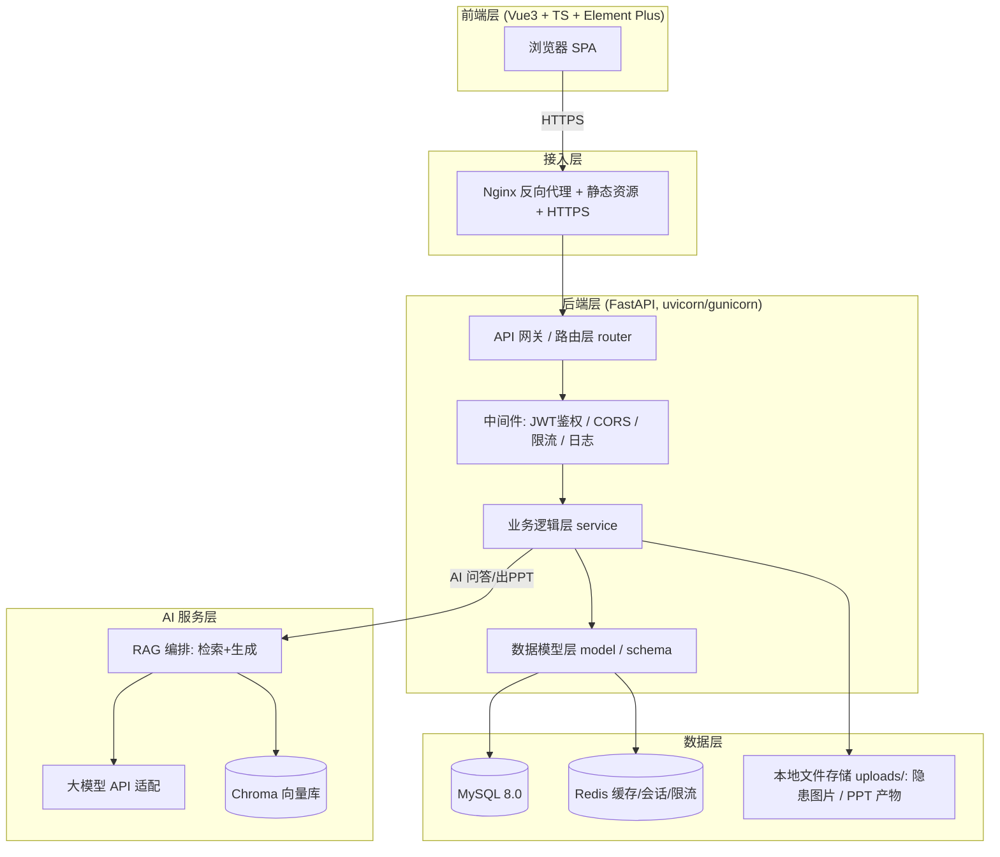

# 蜀道智能安全助手 — 系统架构设计文档

> 版本：v1.0 ｜ 技术栈基线：**Python FastAPI**
>
> ⚠️ 任务书 1.3 原后端为 Spring Boot / NestJS，**实际采用 Python FastAPI**（本课设决策）。下文基于 FastAPI 重新选型并说明理由。

---

## 1. 整体架构

采用**前后端分离 + 分层后端 + RAG 服务**的经典企业架构。



---

## 2. 技术栈选型及理由

| 层级 | 任务书原选型 | **实际选型** | 选型理由 |
|------|-------------|-------------|---------|
| 前端 | Vue3 + TS + Element Plus + Vite | 同左（不变） | 生态成熟、组件全 |
| **后端** | Spring Boot / NestJS | **Python FastAPI** | 原生 `async` 高并发契合 ≥50 QPS；`StreamingResponse` 原生支持 SSE(A03)；类型提示 + Pydantic 自动校验/文档；与 AI/Python 生态（LangChain、python-pptx、Chroma）无缝衔接 |
| ORM | MyBatis Plus | **SQLAlchemy 2.x + SQLModel** | 与 FastAPI/Pydantic 契合；类型安全；异步支持 |
| 数据库 | MySQL 8.0 | 同左（不变） | 关系型主存；事务保障隐患闭环 |
| 缓存/消息 | Redis | 同左（不变） | 会话缓存、接口限流、站内消息队列 |
| 向量库 | 未指定 | **Chroma** | 轻量、本地文件持久化、Python 原生、上手快，契合课程项目 |
| AI 集成 | 国内大模型 API | deepseek-v4-flash作为主模型,接入qwen3.8max作为视觉子模型 | 国内合规、中文能力强 |
| 部署 | Docker + Nginx | 同左（不变） | FastAPI 用 `uvicorn` + `gunicorn` 多 worker |

---

## 3. 后端模块划分与职责（FastAPI 分层）

```
backend/
├── src/
│   ├── main.py              # 应用入口、生命周期、挂载子路由
│   ├── core/                # 配置、安全、数据库、Redis 连接
│   │   ├── config.py        # pydantic-settings 读取环境变量
│   │   ├── security.py      # JWT 签发/校验、BCrypt 密码
│   │   ├── db.py            # SQLAlchemy 引擎/会话
│   │   └── redis.py         # Redis 连接池
│   ├── models/              # ORM 模型 (SQLAlchemy)
│   │   ├── user.py
│   │   ├── hazard.py        # 隐患 H 系列
│   │   ├── conversation.py  # 会话 A 系列
│   │   └── ppt_task.py      # PPT 任务 P 系列
│   ├── schemas/             # Pydantic 请求/响应模型
│   ├── routers/             # 路由层 (APIRouter)
│   │   ├── auth.py
│   │   ├── hazards.py       # H01-H08
│   │   ├── chat.py          # A01-A07 (含 SSE)
│   │   └── ppt.py           # P01-P08
│   ├── services/            # 业务逻辑层
│   │   ├── hazard_service.py
│   │   ├── chat_service.py
│   │   └── ppt_service.py
│   ├── ai/                  # AI 能力封装
│   │   ├── llm_client.py    # 大模型适配
│   │   ├── rag.py           # RAG 检索生成
│   │   └── knowledge.py     # 知识库构建/嵌入
│   ├── middleware/          # JWT 鉴权、CORS、限流、访问日志
│   └── utils/               # 文件上传校验、敏感词等
├── tests/                   # 单元测试 (pytest, 覆盖率≥60%)
├── alembic/                 # 数据库迁移 (可选)
└── pyproject.toml
```

**分层契约**：`router` 只做参数校验与路由，不含业务；`service` 承载业务逻辑与事务；`model` 映射表；`schema` 定义对外契约；`ai` 与 `middleware` 为横切能力。

---

## 4. 数据流向图

### 4.1 隐患上报→闭环
`前端表单 → router 校验 → hazard_service 落库(MySQL) + 触发消息(Redis) → 返回 ID`；
派单/整改/验收均走 `service` 更新状态机字段，详情接口聚合时间线。

### 4.2 AI 流式问答
`前端 EventSource → chat router → chat_service 取会话历史(Redis/MySQL) → rag 检索(Chroma) → llm_client 流式 → StreamingResponse(SSE) → 前端逐字渲染`。

### 4.3 PPT 生成
`主题输入 → ppt_service 调 llm 生成大纲 → 用户编辑 → 调 llm 填充内容 → python-pptx 渲染 → 存本地 uploads/ → 返回下载 URL`。

---

## 5. 部署架构

```mermaid
flowchart LR
    U[用户] --> N[Nginx:80/443]
    N --> F[frontend 静态 (Nginx)]
    N --> B[backend FastAPI:8000 (gunicorn+uvicorn workers)]
    B --> SQL[(MySQL 3306)]
    B --> RD[(Redis 6379)]
    B --> CH[(Chroma 持久化目录)]
    B --> FS[(文件卷: uploads/ppt)]
```

- `docker-compose.yml` 编排：nginx、backend、mysql、redis、chroma（或本地目录）五个服务。
- Backend 通过 `PYTHONUNBUFFERED=1` + gunicorn `--workers` 横向提并发；Nginx 做 HTTPS 终止与静态托管。

---

## 6. 安全性设计

| 风险 | 方案 |
|------|------|
| 密码泄露 | BCrypt 哈希（`passlib[bcrypt]`），不存明文 |
| 越权访问 | JWT 鉴权中间件 + RBAC 角色校验（admin/safety_officer/employee） |
| SQL 注入 | ORM 参数化查询，禁止字符串拼接 SQL |
| XSS | 前端框架天然转义；富文本走白名单清洗 |
| 文件上传 | 类型白名单（图片 jpg/png/webp）、大小限制（≤10MB）、重命名落盘 |
| 敏感操作 | 统一访问/操作日志中间件，记录操作人/时间/对象 |

---

## 7. 技术难度与扩展性

- **AI 集成 + RAG**：Chroma 向量检索 + 大模型生成，是技术难点与评分重点（15% 技术难度）。
- **流式（SSE）**：FastAPI `StreamingResponse` 原生支持，优于轮询。
- **性能**：异步 + Redis 缓存会话与限流，满足 ≥200 并发、P95 ≤ 500ms。
- 后续方向 B（考试工坊）可平行新增 `exam` 路由与模型，不改现有分层。
